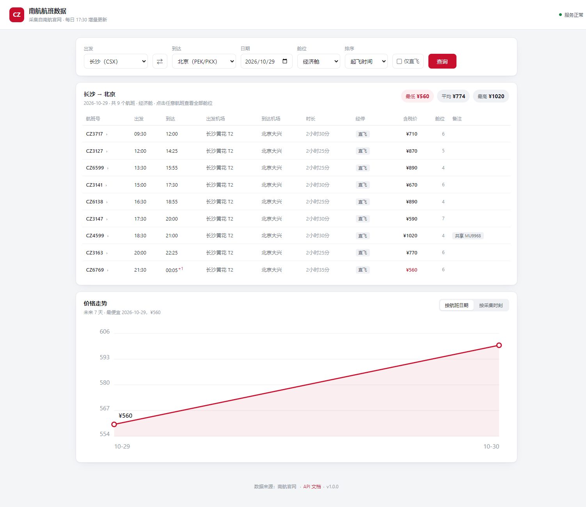
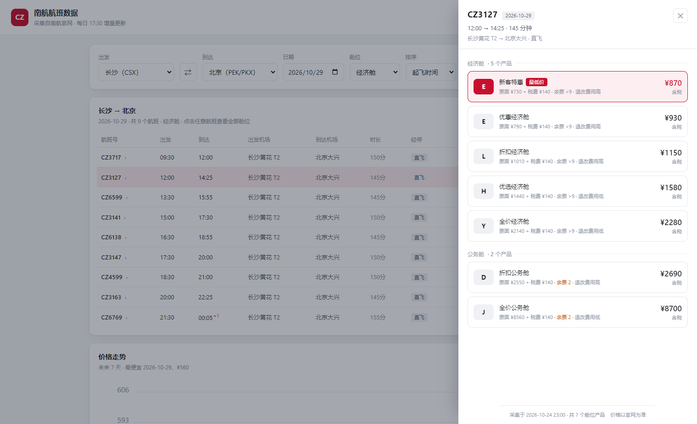
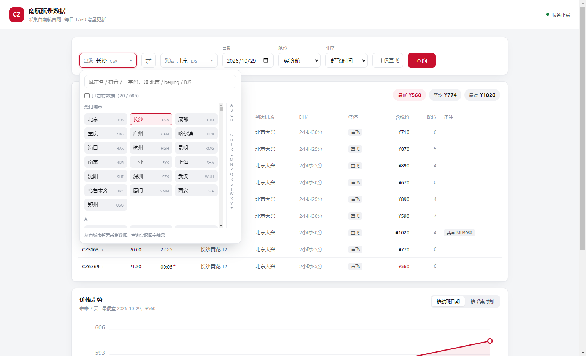

# 航班价格采集与监控系统

把航空公司的公开航班查询接口，做成一套**能长期稳定运行**的数据管道：
定时采集 → 原始响应存档 → 解析入库 → 提供查询 API → 降价邮件提醒。

不是一个脚本，是一个带调度、状态机、熔断、限流的小系统。

> ⚠️ **仅供学习与技术研究。**
> 作者不鼓励、不支持任何违反目标网站服务条款、`robots.txt` 或当地法律法规的使用方式。
> 使用本项目产生的任何后果由使用者自行承担。**详见文末[免责声明](#免责声明)。**

---

## 截图

主界面：查询结果 + 价格走势 + 价格监控



| 舱位明细 | 城市选择器 |
| --- | --- |
|  |  |

---

## 功能

- **航班查询**：单程查询，城市码自动展开为多机场（`BJS` → `PEK` + `PKX`），支持按价格/时间/时长排序、只看直飞
- **舱位明细**：点开任意航班看全部舱位产品，同一舱位下的不同运价产品（不同 `fare_basis`）分别列出
- **价格走势**：手写 SVG 折线图，可按「航班日期」看哪天便宜，也可按「采集时刻」看涨跌
- **城市选择器**：685 个城市，热门城市 + A-Z 分组 + 拼音/三字码/机场码搜索
- **按需采集**：库里没有的数据，查询时**实时采一次并立即入库**，3~4.5 秒出结果
- **价格监控**：设阈值 + 收件邮箱，低于阈值自动发邮件；检查频率按距起飞天数分级
- **采集调度**：Celery 任务状态机，原子抢占、按队列深度补货、30 分钟超时回收
- **反爬应对**：处理验证码、IP 阻断、JS 挑战（`acw_sc__v2`）三类风控，cookie 持久化复用
- **熔断与重试**：按失败原因区分「重试」与「熔断」，致命错误直接停派并告警
- **CLI 工具**：命令行查航班、看走势、每日巡检

---

## 技术栈

| 层 | 选型 |
| --- | --- |
| 语言 | Python 3.11 |
| 接口 | FastAPI + Pydantic v2 |
| 调度 | Celery 5.6 + Redis（broker / backend） |
| 存储 | MySQL 5.7（结构化）、MongoDB（原始响应）、Redis（队列与缓存） |
| 前端 | Vue 3 `<script setup>` + Vite 5，手写 SVG 图表（不引图表库） |
| 请求 | requests + 自建 Session（无 aiohttp / Selenium / Scrapy） |
| 测试 | pytest（含 Redis / MySQL 集成测试） |

---

## 架构

```text
        ┌──────────────┐
        │   Vue 3 前端  │
        └──────┬───────┘
               │ HTTP
        ┌──────▼───────────────┐
        │  FastAPI             │  查询 / 走势 / 舱位 / 监控
        │  - 先查 MySQL         │
        │  - 查不到 → 按需采集   │
        └──────┬───────────────┘
               │
   ┌───────────▼──────────────────────────────┐
   │  Celery beat（定时） + worker（执行）      │
   │  生成任务 → 派发 → 采集 → 解析入库         │
   └───────┬──────────────────────┬───────────┘
           │                      │
    ┌──────▼──────┐        ┌──────▼──────┐
    │  MongoDB    │        │   MySQL     │
    │  原始响应    │───────►│  结构化数据  │
    │  (gzip)     │  解析   │             │
    └─────────────┘        └─────────────┘
           ▲
           │
    ┌──────┴──────┐
    │  航空官网接口 │  ← 主动限速
    └─────────────┘
```

**两个刻意的设计：**

1. **采集与解析分离**。采集只把原始响应 gzip 存进 MongoDB，解析由另一个定时任务扫。
   接口改版时可以**只重跑解析**，不用重新打接口——省配额、也躲风控。
2. **睡眠在会话层，不在任务层**。
   这个等待放在任务末尾会堵住 worker；放在"资源可用时间"上，worker 就能继续干活。

---

## 快速开始

### 环境要求

- Python 3.11+
- MySQL 5.7+（注意：用了 `utf8mb4_general_ci`，不是 8.0 的默认排序规则）
- MongoDB 4.x+
- Redis 6+
- Node.js 18+（只在构建前端时需要）

### 1. 建库建表

```bash
mysql -u root -p < schema.sql
```

`schema.sql` 会创建数据库、7 张表和视图，并说明 MySQL 5.7 的兼容性取舍。

### 2. 配置

编辑 `csair_spider/csair/settings.py`，修改 MySQL / MongoDB / Redis 连接。

准备凭证（**这两个文件不会被提交，见 `.gitignore`**）：

```bash
cd csair_spider/info
cp token.txt.example token.txt    # 填入登录 TOKEN
cp mail.txt.example  mail.txt     # 只有用价格监控才需要
```

`token.txt` 也可以改用环境变量：`export CSAIR_TOKEN=xxx`。

### 3. 初始化主数据

```bash
cd csair_spider
python -m csair.cli.check          # 首次运行会灌入城市/机场主数据
```

### 4. 构建前端

```bash
cd frontend
npm install
npm run build                       # 输出到 csair_spider/csair/web/
```

### 5. 启动

```bash
# ① 采集 worker + 定时器（两个 Celery 进程）
cd csair_spider
celery -A csair.celery_app worker -l info -c 1 --pool=solo
celery -A csair.celery_app beat   -l info

# ② 接口服务（单独一个进程）
python -m csair.api.main
```

打开 <http://127.0.0.1:8000/> 即可。接口文档在 <http://127.0.0.1:8000/docs>。

## 项目结构

```text
csair_spider/ 
│   ├── csair/
│   │   ├── settings.py         配置集中地
│   │   ├── spider.py           采集层（HTTP + 三级风控）
│   │   ├── parser.py           解析层（纯函数，可单测）
│   │   ├── storage.py          落地层（Mongo 原文 / MySQL 结构化）
│   │   ├── queries.py          只读查询层（CLI 与 API 共用）
│   │   ├── ondemand.py         按需采集
│   │   ├── monitor.py          价格监控
│   │   ├── notify.py           邮件 / Webhook
│   │   ├── cookies.py          cookie 缓存（Redis）
│   │   ├── jobs.py             Celery 任务
│   │   ├── api/                FastAPI 接口
│   │   ├── cli/                命令行工具
│   │   └── data/               静态城市数据（生成物，勿手改）
│   └── info/                   凭证（gitignore）
├── frontend/                   Vue 3 + Vite
├── schema.sql                  建表脚本
```

---

## 已知不足

老实列出来，避免误用。分三类。

### 一、功能缺口

| 缺口 | 影响 |
| --- | --- |
| **没有鉴权** | 所有接口公开。`GET /api/monitors` 会返回全部监控规则（含邮箱）。**不能直接部署到公网** |
| **没有用户体系** | `user_id` 固定为 1；监控列表存在浏览器 `localStorage`，换设备/清缓存就丢 |
| **无航班动态** | `flight_dynamic` 表建了但没数据（动态接口未接入） |
| **无数据导出** | 没有 Excel/CSV 导出、没有管理后台 |

### 二、工程债

| 项 | 说明 |
| --- | --- |
| Windows 优先 | `service.bat` 依赖 nssm； |
| 测试需要真实中间件 | 没有 mock 版的 MySQL/Redis，纯单元测试跑不全 |
| 前端无路由/状态管理 | 单页面，没上 Vue Router / Pinia，也没有 TypeScript |
| 城市数据是静态快照 | `city_code.py` 是离线生成物，机场变更不会自动同步 |

### 三、架构边界（设计选择，不是 bug）

| 选择 | 原因 |
| --- | --- |
| 不用 Scrapy / aiohttp / Selenium | 瓶颈在主动限速（10~20 秒/次），不在框架。单请求场景下 `requests` 更好控制重试与 cookie |
| 不用 ECharts | 只有一张折线图，手写 SVG 省 500KB 依赖 |
| 两阶段存储会增加延迟 | 批采数据最多 5 分钟才可查；换来的是"接口改版只重跑解析" |
| 价格快照小时粒度 | 同一小时内多次采集只留一份；对趋势判断够用，做不了分钟级分析 |
| 解析强依赖响应结构 | 目标接口改版会导致解析失败，需要人工适配 |

### 如果你要用它

至少先做这三件事：

1. 加鉴权（或只在内网 / 本机跑）
2. 把 `info/token.txt` 的更新做成半自动（失效告警 + 一键替换）
3. 给 `dispatch_monitor` 的日预算和 `ondemand` 的限速按自己的量级重算

---

## 免责声明

> **请在使用前完整阅读本节。**

### 1. 用途限定

本项目为**个人学习与技术研究**而编写，用于演示以下工程问题的解决方式：

- 有限带宽下的任务调度与限速
- 原始数据存档与结构化解析的分层
- 幂等写入、失败重试与熔断
- 只读接口与写操作的边界划分
- 可测试性设计（打桩、隔离数据）

**它不是为生产环境的商业数据采集而设计的。**

### 2. 合规责任

使用本项目时，你**必须自行确认并遵守**：

- 目标网站的 `robots.txt` 与服务条款（ToS）
- 《中华人民共和国网络安全法》《数据安全法》《个人信息保护法》
- 《反不正当竞争法》中关于数据抓取的相关规定
- 你所在国家/地区的相关法律法规

本项目**不提供**任何规避法律限制的手段。

### 3. 明确禁止的用途

以下行为**均非本项目设计意图**，作者明确反对：

- 商业转售采集到的数据
- 高频爬取、分布式压测、对目标服务造成负担
- 绕过登录、付费墙或访问控制
- 批量注册账号、盗用他人账号或凭证
- 用于票价操纵、价格欺诈、刷单等不正当竞争
- 采集、存储、传播任何个人隐私信息

### 4. 责任豁免

- 本项目按「现状」提供，**不附带任何明示或暗示的担保**，包括但不限于可用性、准确性、特定用途适用性
- 作者**不对使用本项目造成的任何直接或间接损失负责**，包括但不限于：账号被封、IP 被封、服务中断、数据丢失、法律纠纷、商业损失
- 因使用本项目而违反任何法律法规或第三方协议，**责任完全由使用者承担**
- 项目中的目标网站名称仅用于说明技术背景，**与该公司无任何关联、合作或授权关系**

### 5. 数据归属

- 采集到的航班、价格等数据**归原权利人所有**，本项目不对其主张任何权利
- 仓库中不含任何真实采集数据，`tests/fixtures/` 下的样本已脱敏
- 项目代码与采集数据是两回事：**MIT 许可只覆盖代码，不覆盖任何数据**

### 6. 移除请求

若相关权利人认为本项目存在侵权，请通过 Issue 联系，作者会**在确认后第一时间删除仓库**。

### 7. 使用即视为同意

下载、克隆、fork 或以任何方式使用本项目，即表示你已阅读、理解并同意上述全部条款。

